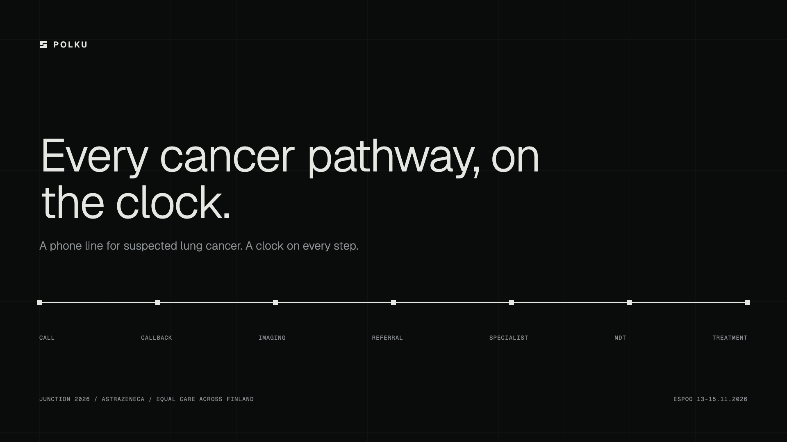
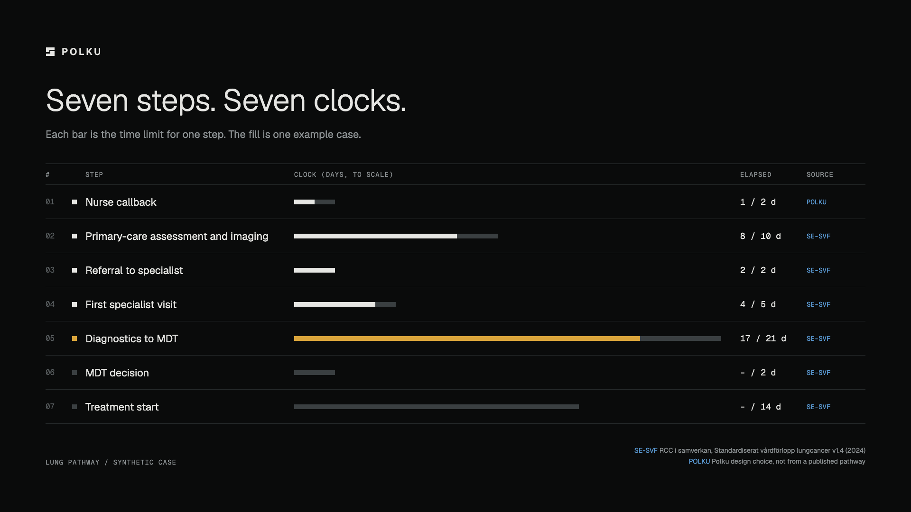

<p align="center">
  
</p>

<p align="center">
  <a href="https://polku.ender.fi/demo"><b>Live demo</b></a> ·
  <a href="docs/product.md">Product</a> ·
  <a href="docs/lung-pathway-sources.md">Sources</a> ·
  Junction 2026 / AstraZeneca "Equal Care Across Finland"
</p>

---

**Polku does the handoffs between cancer care steps.** A patient calls a phone line and describes their symptoms. A rules engine checks them against published Nordic lung cancer criteria. The nurse gets one small task with a time already proposed. They accept, Polku calls the patient back and books it, and the case moves on to the next step with its own clock.

Finland measures cancer care equality by target times, but nothing records those times per county, and there is no national lung pathway yet. Polku runs the pathway, so the measurement comes out of it.

## How it works

```
call ──▶ identify ──▶ extract symptoms ──▶ match criteria ──▶ nurse task ──▶ callback ──▶ next step
         Mobile ID     LLM, typed only      deterministic       one click     voice agent    on the clock
```

- **The LLM never triages.** It only turns speech into typed symptoms. Matching is deterministic, in [`src/pathways/lung.ts`](src/pathways/lung.ts), and every criterion cites its source.
- **Red flags always mean "call 112"**, enforced in the engine, not the prompt.
- **The caller only sees their own case**, after identification. Every access is logged.
- **Patients only use a phone.** Every screen is for staff.

<p align="center">
  
</p>

## Run it

```sh
nix-shell                     # or any Node 22
cp .env.example .env.local
npm install
npm run db:up && npm run db:push && npm run db:seed
npm run dev                   # http://localhost:3000
```

Or all in Docker: `npm run up`. Voice calls need an ElevenLabs agent ([`agent/README.md`](agent/README.md)). Deploy and the phone line: [`docs/deploy.md`](docs/deploy.md).

## Stack

Next.js 16 · React 19 · TypeScript · Tailwind 4 · zod · Drizzle + Postgres · ElevenLabs + Twilio · vitest

| Path | What |
|---|---|
| `src/pathways/` | Lung pathway: criteria, steps, time limits, sources |
| `src/ontology/` | Intake schema and rules engine |
| `src/server/` | Calls, identification, nurse actions, live updates |
| `src/app/` | Staff screens and API |
| `agent/` | Voice agent prompt and tools |

## Limits

Synthetic data only. Identification is simulated. Target times are Swedish placeholders until Finland sets its own. Not a medical device: a nurse makes every clinical decision.

MIT
