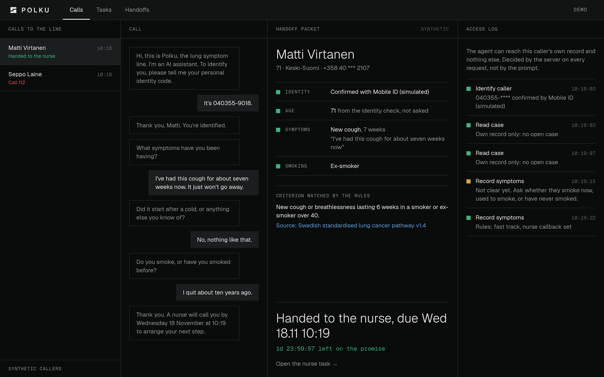
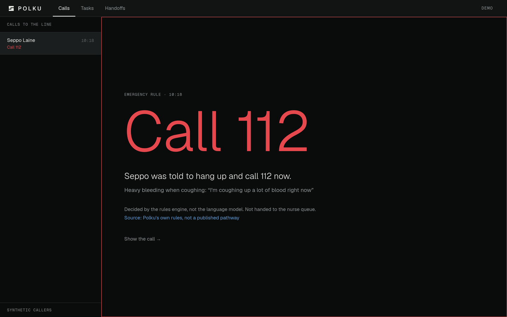
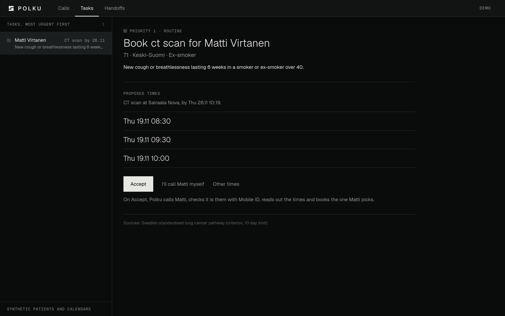
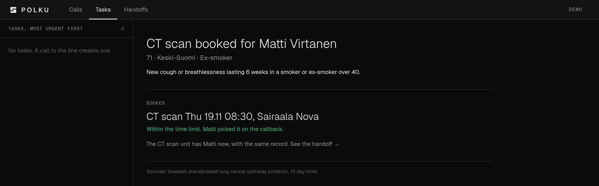
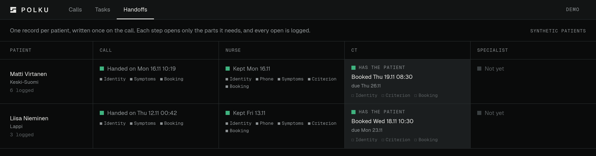

<p align="center">
  <picture>
    <source media="(prefers-color-scheme: dark)" srcset="docs/brand/kit/logo/svg/polku-lockup.svg">
    
  </picture>
</p>

<p align="center">
  <a href="https://polku.ender.fi/demo">Live demo</a> ·
  <a href="docs/video/PolkuV3.mp4">Video (2 min)</a> ·
  <a href="docs/Polku-white-paper.pdf">White paper</a> ·
  <a href="docs/pitch/polku-deck.pdf">Pitch deck</a>
</p>

Polku is a phone line that does the handoffs between cancer care steps. A patient calls and describes their symptoms, a rules engine checks them against published Nordic lung cancer criteria, and the nurse gets one task with a time already proposed. When the nurse accepts, Polku calls the patient back and books it, and the same record moves on to the next step with its own deadline.

We built it over a weekend at Junction 2026 in Espoo (13-15 Nov 2026) for AstraZeneca's "Equal Care Across Finland" challenge. The project is archived. The scripted demo site stays up for now. Production, the phone number and the hosted model are shut down.

## Why

Finland has no national lung cancer pathway yet, and the national cancer strategy measures equality by treatment within target times, but nothing records those times per county. Sweden and Denmark publish entry criteria and a time limit for every step. Polku runs a pathway like that, so the measurement comes out of running it. Background and sources: [`docs/product.md`](docs/product.md), [`docs/lung-pathway-sources.md`](docs/lung-pathway-sources.md), [`docs/strategy.md`](docs/strategy.md).

## What it looks like

Patients only ever use a phone. Every screen is for staff.

The call. The agent identifies the caller first, then the handoff packet fills while they talk: symptoms next to the caller's own words, the criterion the rules matched with its source, and the deadline the caller was promised. The access log on the right shows every tool call the agent made and whether the server allowed it.



Red flags. Coughing up a lot of blood, severe breathlessness or sudden chest pain end the call with "call 112". The engine decides this, not the language model, and the case never reaches the nurse queue.



The nurse task. One decision per patient. The times are proposed by a rule: free slots on a resource in the patient's county that can do the next step, before that step's limit.



After Accept, the agent calls the patient back, reads out the times and books the one they pick.



The handoff strip. One line per patient, who has them now, the deadline for that handoff, and which parts of the record each step opened.



## How it works

```
call ─▶ identify ─▶ extract symptoms ─▶ match criteria ─▶ nurse task ─▶ callback ─▶ next step
        hetu +       LLM, typed          deterministic,     one click    voice agent   same record,
        Mobile ID    tool calls only     cited sources                   books it      new clock
```

- The LLM never triages. It turns speech into typed symptom objects and nothing else. Matching is deterministic, in [`src/ontology/engine.ts`](src/ontology/engine.ts) against [`src/pathways/lung.ts`](src/pathways/lung.ts), and every criterion cites its source.
- Red flags always return "call 112", enforced in the engine.
- Before identification the agent can read nothing about anyone. After it, only the caller's own record. The server enforces this in [`src/server/identity.ts`](src/server/identity.ts), and every access is logged.
- The voice agent ran on ElevenLabs, with Qwen3 on a Verda GPU in the EU as its language model and Aiven Postgres holding the records, clocks and access logs.

The full technical walkthrough is in [`docs/architecture.md`](docs/architecture.md).

## What was real

The browser and phone calls, identification by identity code, the rules, the clocks, the nurse task and the booking callback all worked end to end up to the CT handoff. Patients, Mobile ID and the hospital calendars were synthetic, and the steps after CT were seeded. Target times are Swedish placeholders until Finland sets its own. It's a hackathon prototype, not a medical device.

## Run it

```sh
nix-shell                     # or any Node 22
cp .env.example .env.local
npm install
npm run db:up && npm run db:push && npm run db:seed
npm run dev                   # http://localhost:3000, start at /demo
```

Without an ElevenLabs agent the scripted callers on `/demo` stand in for the phone. Voice setup is in [`agent/README.md`](agent/README.md), deployment in [`docs/deploy.md`](docs/deploy.md).

Stack: Next.js 16, React 19, TypeScript, Tailwind 4, zod, Drizzle and Postgres, ElevenLabs and Twilio, vLLM on Verda, vitest.

## Repo

| Path | What |
|---|---|
| `src/pathways/` | The lung pathway: criteria, steps, time limits, sources |
| `src/ontology/` | Intake schema, rules engine, record parts, care data, ontology graph |
| `src/server/` | Calls, identity gate, cases, scheduling, phone, LLM proxy |
| `src/app/` | Staff screens and API routes |
| `agent/` | Voice agent prompt, tools and the Verda model deploy |
| `docs/` | Architecture, product, sources, design, pitch material, video, hackathon notes. Index in [`docs/README.md`](docs/README.md) |

MIT licensed.
